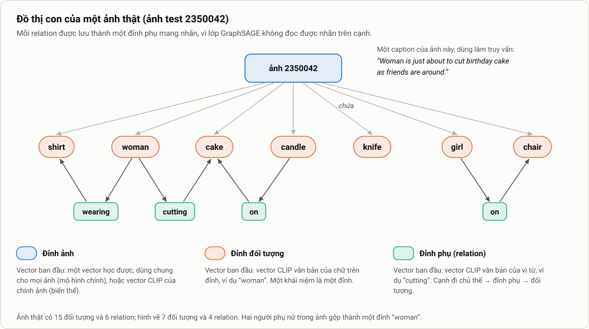
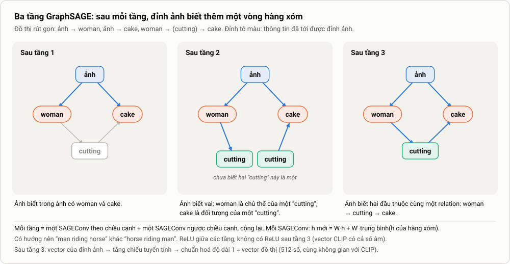
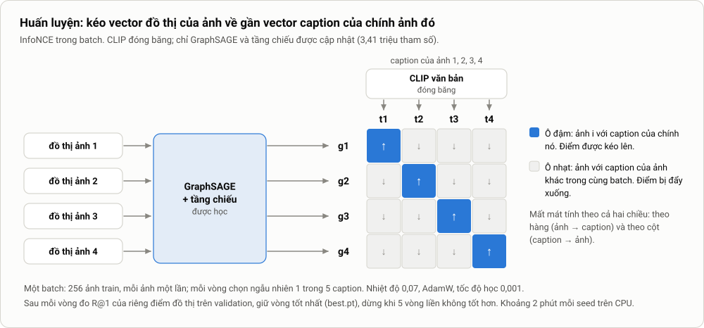
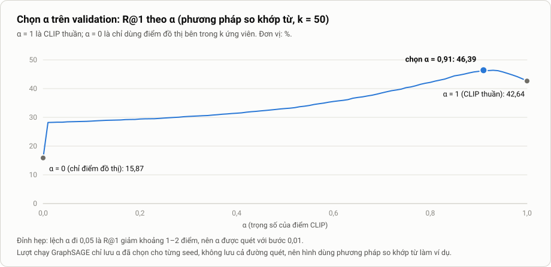
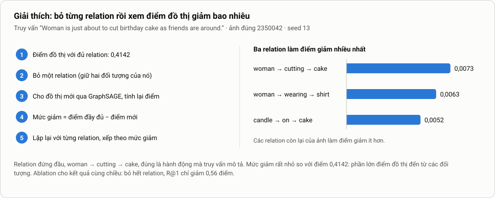

# 3. Mô hình: từ đồ thị cảnh đến điểm đồ thị

> **Nói đơn giản.** Mỗi ảnh có sẵn một sơ đồ ghi trong ảnh có vật gì, và vật nào làm gì với vật nào. GraphSAGE đọc sơ đồ đó qua 3 vòng “hỏi hàng xóm”, rồi tóm cả sơ đồ thành một dãy 512 số, gọi là **vector đồ thị**. Mô hình được luyện để vector này giống vector CLIP của câu mô tả đúng. **Điểm đồ thị** chính là độ giống nhau giữa hai vector đó.

GraphSAGE ở đây là bộ mã hoá **biến một đồ thị thành một vector**. Nó không tự nhìn ảnh và không sinh đồ thị: đồ thị có sẵn từ nhãn do người gán của Visual Genome (xem [tài liệu 2](02-du-lieu.md)).

Phần GraphSAGE đi qua sáu bước:

| Bước | Việc | Ví von |
|---|---|---|
| [1](#bước-1-đồ-thị-con-của-một-ảnh) | Dựng đồ thị của ảnh | Vẽ sơ đồ: trong ảnh có gì, ai làm gì với ai |
| [2](#bước-2-mỗi-đỉnh-bắt-đầu-bằng-một-dãy-số) | Gán dãy số ban đầu cho từng đỉnh | Mỗi ô trong sơ đồ có một “hồ sơ” ban đầu |
| [3](#bước-3-ba-vòng-hỏi-hàng-xóm) | Ba vòng hỏi hàng xóm | Cả lớp hỏi bạn ngồi cạnh, ba lượt |
| [4](#bước-4-tóm-cả-đồ-thị-thành-một-vector) | Tóm thành một vector | Đỉnh ảnh viết bản tóm tắt |
| [5](#bước-5-học-bằng-trò-chơi-ghép-cặp) | Học | Trò chơi ghép ảnh với câu của nó |
| [6](#bước-6-chấm-điểm-lúc-tìm-ảnh) | Chấm điểm lúc tìm ảnh | So bản tóm tắt với câu hỏi |

## Bước 1. Đồ thị con của một ảnh

> **Nói đơn giản.** Sơ đồ của một ảnh được vẽ thành các ô (**đỉnh**) nối nhau bằng mũi tên (**cạnh**). Mỗi quan hệ, như “cắt”, cũng thành một ô nhỏ nằm giữa hai vật.

Ví dụ thật: ảnh test 2350042, có câu mô tả “Woman is just about to cut birthday cake as friends are around.” Người gán nhãn đã ghi các vật (woman, cake, candle, knife…) và các quan hệ (woman cutting cake, candle on cake…). Mỗi ảnh có một đồ thị nhỏ của riêng nó:



Đồ thị có ba loại đỉnh:

- **Đỉnh ảnh:** mỗi ảnh một đỉnh, có cạnh “chứa” tới mọi vật của ảnh.
- **Đỉnh đối tượng:** mỗi khái niệm có trong ảnh là một đỉnh. Hai người phụ nữ trong ảnh vẫn chung một đỉnh `woman`.
- **Đỉnh phụ (relation):** mỗi quan hệ thành một đỉnh mang tên vị từ, đặt giữa chủ thể và đối tượng: `woman → (cutting) → cake`. Chiều mũi tên cho biết ai là chủ thể (woman), ai là đối tượng (cake).

**Vì sao cần đỉnh phụ?** GraphSAGE chỉ đọc được nội dung của đỉnh, không đọc được chữ ghi trên mũi tên. Nếu chỉ nối `woman — cake`, mô hình không phân biệt được “woman cutting cake” với “woman next to cake”. Khi vị từ thành một đỉnh, nó có vector riêng và được đưa vào tính toán. Về ý nghĩa, relation vẫn là quan hệ giữa hai vật; đỉnh phụ chỉ là cách lưu.

**Mỗi ảnh một đồ thị riêng.** Các đồ thị không nối với nhau, nên qua đồ thị, ảnh test không thể ảnh hưởng tới ảnh train.

Code: `src/models/graph_data.py`. Kiến thức nền: [A4. Đồ thị](phu-luc-a-kien-thuc-nen.md#a4-đồ-thị-đỉnh-cạnh-có-hướng-edge_index), [A5. Đồ thị cảnh](phu-luc-a-kien-thuc-nen.md#a5-đồ-thị-cảnh-visual-genome-và-wordnet).

## Bước 2. Mỗi đỉnh bắt đầu bằng một dãy số

> **Nói đơn giản.** Máy tính không hiểu chữ, nên trước khi tính, mỗi đỉnh được đổi thành một dãy 512 con số, gọi là **vector**.

| Đỉnh | Vector ban đầu |
|---|---|
| Đối tượng | Vector CLIP văn bản của chữ trên đỉnh, ví dụ “woman” |
| Đỉnh phụ | Vector CLIP văn bản của vị từ, ví dụ “cutting” |
| Ảnh, trong mô hình chính | Một vector học được, **dùng chung cho mọi ảnh** |
| Ảnh, trong biến thể | Vector CLIP của chính ảnh đó |

Lấy vector từ CLIP có lợi: CLIP đã học nghĩa của chữ, nên hai chữ gần nghĩa như “cake” và “pie” bắt đầu bằng hai vector gần nhau.

**Vì sao đỉnh ảnh của mô hình chính dùng vector chung?** Vì như vậy, đỉnh ảnh không biết gì về ảnh của mình; mọi thông tin phải đi tới nó qua đồ thị. Nhờ đó trả lời rõ được câu hỏi: phần cải thiện có thật sự đến từ đồ thị không? Biến thể dùng vector CLIP của ảnh thường cho số cao hơn, nhưng điểm đồ thị của nó đã lẫn thông tin CLIP của ảnh.

## Bước 3. Ba vòng hỏi hàng xóm

> **Nói đơn giản.** Ở mỗi vòng, mọi đỉnh cùng lúc cập nhật vector của mình bằng cách trộn vector của chính nó với trung bình vector của các đỉnh kề bên. Sau mỗi vòng, đỉnh ảnh “nghe” xa thêm một bước. Mỗi vòng là một **tầng** GraphSAGE; mô hình có 3 tầng.

**Ví von.** Cả lớp ngồi theo sơ đồ chỗ ngồi. Mỗi vòng, ai cũng hỏi các bạn ngồi cạnh rồi ghi lại điều mới biết. Sau vòng 1, mỗi bạn biết về các bạn ngồi cạnh; sau vòng 2, biết cả bạn của bạn; sau vòng 3, biết xa thêm một bước nữa.

Cụ thể, ở mỗi vòng, vector mới của một đỉnh được trộn từ ba thứ:

1. vector hiện tại của chính nó;
2. trung bình vector của các đỉnh **trỏ tới nó**;
3. trung bình vector của các đỉnh **nó trỏ tới**.

Tỉ lệ trộn không do người đặt, mà do mô hình tự học ở bước 5. Hai chiều mũi tên được trộn bằng **hai bộ tỉ lệ khác nhau**; nếu dùng chung, “man riding horse” và “horse riding man” sẽ cho cùng một vector.

Hình dưới dùng đồ thị rút gọn: ảnh → woman, ảnh → cake, woman → (cutting) → cake. Ô tô màu là những gì đã tới được đỉnh ảnh:



| Sau vòng | Đỉnh ảnh biết thêm | Vì sao |
|---|---|---|
| 0 (ban đầu) | Chưa biết gì về ảnh này | Nó chỉ có vector chung cho mọi ảnh |
| 1 | Ảnh có woman và cake | Đỉnh ảnh nghe các đỉnh nó trỏ tới, tức các vật |
| 2 | woman là chủ thể của một “cutting”; cake là đối tượng của một “cutting” | Ở vòng 1, mỗi vật đã nghe đỉnh cutting nằm cạnh nó; ở vòng 2, đỉnh ảnh nghe lại các vật |
| 3 | woman và cake là hai đầu của **cùng một** “cutting”: chính woman cắt chính cake | Ở vòng 1, đỉnh cutting đã nghe cả hai đầu; tin đó tới các vật ở vòng 2, tới đỉnh ảnh ở vòng 3 |

**Vì sao cần đúng 3 vòng?** Nếu ảnh chỉ có một relation `cutting` thì 2 vòng là đủ. Vòng 3 cần khi một ảnh có nhiều relation cùng vị từ: “man riding bicycle, woman riding horse” phải cho vector khác “man riding horse, woman riding bicycle”. Chỉ với 2 vòng, hai ảnh này cho cùng một vector; điều này được kiểm bằng test `test_two_layers_know_each_objects_role_and_three_layers_know_who_goes_with_whom`.

<details>
<summary>Công thức một vòng và chi tiết cài đặt</summary>

Với $\mathbf{h}_i^{(\ell)}$ là vector của đỉnh $i$ sau $\ell$ vòng:

$$
\mathbf{h}_i^{(\ell+1)}=\sigma\Bigl(W_1^{(\ell)}\mathbf{h}_i^{(\ell)}+W_2^{(\ell)}\operatorname*{mean}_{j\to i}\mathbf{h}_j^{(\ell)}+W_3^{(\ell)}\operatorname*{mean}_{i\to j}\mathbf{h}_j^{(\ell)}\Bigr)
$$

- $j\to i$ là các đỉnh trỏ tới $i$; $i\to j$ là các đỉnh mà $i$ trỏ tới. $W_1, W_2, W_3$ là các ma trận học được, mỗi vòng một bộ riêng. Hệ số tự do được bỏ qua cho gọn.
- $\sigma$ là ReLU ở vòng 1 và 2. Vòng 3 không có ReLU, vì vector CLIP có cả số âm.
- Trong code, mỗi vòng là `DirectedSAGELayer` (`src/models/graphsage.py`): tổng của hai lớp `SAGEConv` của PyTorch Geometric, một lớp gom tin theo chiều cạnh, một lớp ngược chiều cạnh. Phần vector của chính đỉnh có ở cả hai lớp; cộng lại thành $W_1$. Config có cờ `directed: false` để tắt hướng khi làm ablation.
- Mỗi `SAGEConv` là GraphSAGE biến thể trung bình, xem [A8](phu-luc-a-kien-thuc-nen.md#a8-mạng-nơ-ron-đồ-thị-gcn-gat-graphsage). Một tầng tính bằng số cụ thể có ở [B3](phu-luc-b-tinh-tay-tu-dau-den-cuoi.md#b3-graphsage-tầng-1).

</details>

## Bước 4. Tóm cả đồ thị thành một vector

> **Nói đơn giản.** Sau vòng 3, đỉnh ảnh đã nghe được cả đồ thị. Vector của nó, sau một phép biến đổi cuối, là bản tóm tắt của cả ảnh.

- Vector của đỉnh ảnh sau vòng 3 đi qua một **tầng chiếu** tuyến tính để về cùng không gian với CLIP, rồi được chuẩn hoá về độ dài 1. Kết quả là **vector đồ thị** của ảnh, gồm 512 số.
- Toàn bộ mô hình có 3,41 triệu tham số học được, với chiều ẩn 512.
- Sau khi huấn luyện, vector đồ thị của cả 10.000 ảnh được tính một lần rồi lưu lại.

<details>
<summary>Công thức</summary>

$$
\mathbf{g}=\frac{P\mathbf{h}_{\text{img}}^{(3)}}{\lVert P\mathbf{h}_{\text{img}}^{(3)}\rVert}
$$

$P$ là tầng chiếu, $\mathbf{h}_{\text{img}}^{(3)}$ là vector của đỉnh ảnh sau vòng 3. Chuẩn hoá được giải thích ở [A7](phu-luc-a-kien-thuc-nen.md#a7-tầng-tuyến-tính-relu-và-chuẩn-hoá); tính bằng số ở [B5](phu-luc-b-tinh-tay-tu-dau-den-cuoi.md#b5-tầng-chiếu-và-chuẩn-hoá-vector-đồ-thị).

</details>

## Bước 5. Học bằng trò chơi ghép cặp

> **Nói đơn giản.** Lúc đầu, các tỉ lệ trộn là ngẫu nhiên nên vector đồ thị chưa mang nghĩa gì. Mô hình học bằng một trò chơi ghép: trong một nhóm ảnh và câu, mỗi ảnh phải nhận ra câu của mình, và mỗi câu phải nhận ra ảnh của mình.



1. **Lấy một nhóm (batch).** 256 ảnh train, mỗi ảnh một lần, kèm một câu mô tả của chính nó, chọn ngẫu nhiên 1 trong 5 câu ở mỗi vòng.
2. **Lập bảng điểm 256 × 256.** So vector đồ thị của mọi ảnh với vector CLIP của mọi câu.
3. **Chỉnh tỉ lệ trộn.** Đẩy điểm của cặp đúng (đường chéo) lên cao hơn mọi cặp sai, theo cả hai chiều: từ ảnh tìm câu, và từ câu tìm ảnh. Cách học này gọi là **InfoNCE** (học tương phản).
4. **Lặp lại và dừng sớm.** Sau mỗi vòng, đo R@1 của riêng điểm đồ thị trên 1.500 ảnh validation; vòng tốt nhất được lưu thành `best.pt`. Dừng khi 5 vòng liên tiếp không tốt hơn, tối đa 50 vòng.

CLIP đóng băng. Chỉ GraphSAGE, tầng chiếu và vector dùng chung của đỉnh ảnh được cập nhật.

Thu nhỏ còn 4 ảnh để dễ hình dung (số minh hoạ; ô in đậm là cặp đúng). Trước khi học, ô của cặp đúng không nổi bật; ở hàng ảnh A, ô cao nhất còn rơi vào câu của B:

| Trước khi học | câu của A | câu của B | câu của C | câu của D |
|---|---|---|---|---|
| ảnh A | **0,21** | 0,35 | 0,18 | 0,27 |
| ảnh B | 0,30 | **0,12** | 0,25 | 0,22 |
| ảnh C | 0,16 | 0,28 | **0,24** | 0,31 |
| ảnh D | 0,26 | 0,19 | 0,33 | **0,20** |

Sau khi học, trong mỗi hàng và mỗi cột, ô của cặp đúng đều cao nhất:

| Sau khi học | câu của A | câu của B | câu của C | câu của D |
|---|---|---|---|---|
| ảnh A | **0,62** | 0,21 | 0,15 | 0,18 |
| ảnh B | 0,19 | **0,58** | 0,22 | 0,12 |
| ảnh C | 0,14 | 0,20 | **0,66** | 0,17 |
| ảnh D | 0,22 | 0,16 | 0,13 | **0,60** |

<details>
<summary>Công thức InfoNCE</summary>

Với $\mathbf{g}_a$ là vector đồ thị của ảnh $a$, $\mathbf{t}_b$ là vector CLIP của câu $b$, $S_{ab}=\mathbf{g}_a\cdot\mathbf{t}_b$, batch có $B$ cặp và nhiệt độ $\tau$:

$$
\mathcal{L}=\frac{1}{2B}\sum_{a=1}^{B}\Bigl[-\log\frac{e^{S_{aa}/\tau}}{\sum_{b}e^{S_{ab}/\tau}}-\log\frac{e^{S_{aa}/\tau}}{\sum_{b}e^{S_{ba}/\tau}}\Bigr]
$$

Mỗi hàng của bảng giống một câu hỏi trắc nghiệm có $B$ lựa chọn, đáp án nằm ở đường chéo. Số hạng thứ nhất phạt khi ảnh không chọn đúng câu, số hạng thứ hai phạt khi câu không chọn đúng ảnh. Nhiệt độ τ = 0,07 làm chênh lệch giữa các ô rõ hơn. Giải thích chi tiết ở [A10](phu-luc-a-kien-thuc-nen.md#a10-softmax-cross-entropy-nhiệt-độ-và-infonce); tính bằng số ở [B10](phu-luc-b-tinh-tay-tu-dau-den-cuoi.md#b10-huấn-luyện-loss-infonce-cho-batch-gồm-a-và-b). Code: hàm `info_nce` trong `src/models/train.py`.

</details>

### Chi tiết cho người chạy code

| Tham số | Giá trị | Ghi chú |
|---|---|---|
| Số tầng, chiều ẩn | 3, 512 | |
| Batch | 256 | |
| Tốc độ học, weight decay | 0,001 và 0,0001 | AdamW |
| Nhiệt độ của InfoNCE | 0,07 | |
| Ngưỡng cắt gradient | 1,0 | |
| Dừng sớm | 5 vòng | Theo R@1 trên validation |
| Seed | 13, 37, 97 | |
| Thiết bị | CPU | Với các đồ thị nhỏ này, CPU nhanh hơn MPS. Khoảng 1–2,5 phút mỗi seed |

Đây là các giá trị khởi đầu, **chưa tinh chỉnh**.

Huấn luyện được thiết kế để chạy lại cho ra đúng kết quả cũ:

- Checkpoint `last.pt` được lưu sau mỗi vòng, ghi qua file tạm rồi mới đổi tên, nên bị ngắt giữa chừng cũng không hỏng file.
- Nếu bị ngắt, `--resume` chạy tiếp và cho đúng kết quả như khi chạy liền mạch.
- Nếu loss thành NaN, huấn luyện dừng trước khi cập nhật trọng số.
- Cùng một seed cho ra cùng một `history.json`.

## Bước 6. Chấm điểm lúc tìm ảnh

> **Nói đơn giản.** Khi có câu truy vấn, điểm đồ thị của một ảnh là độ giống nhau (cosine) giữa vector đồ thị của ảnh và vector CLIP của câu. Điểm này được trộn với điểm CLIP theo α; mục [Chấm điểm và xếp hạng lại](#chấm-điểm-và-xếp-hạng-lại) ngay dưới đây giải thích chi tiết.

**Đồ thị giúp được bao nhiêu?** R@1 trên test:

| Cách chấm | R@1 |
|---|---|
| Chỉ dùng điểm đồ thị | 27,78 ± 0,63% (lượt 17/11) |
| Chỉ dùng CLIP | 43,89% |
| Trộn CLIP với điểm đồ thị | 48,20 ± 0,05% (lượt 17/11); 48,12 ± 0,23% (lượt chạy lại 18/11) |

Một mình, điểm đồ thị yếu hơn CLIP nhiều. Điểm này có thể bổ sung tín hiệu chú giải cho CLIP khi kết hợp, nhưng mức tăng chưa chứng minh mô hình đã hiểu quan hệ “ai làm gì với ai”. Cần đọc ablation để tách đóng góp của danh sách vật thể, nhãn vị từ và cấu trúc cạnh. Thí nghiệm bỏ hết relation, chỉ giữ đối tượng, làm R@1 giảm 0,56 điểm phần trăm (khoảng 95%: 0,05 đến 1,06): relation có giúp, dù không nhiều. Riêng nhãn vị từ cụ thể (cutting, riding…) thì chưa chứng minh được là giúp rõ ràng. Chi tiết ở mục [Ablation](#ablation-và-kiểm-tra-lời-giải-thích) và [tài liệu 4](04-ket-qua.md).

## Chấm điểm và xếp hạng lại

Sau khi huấn luyện, vector đồ thị của cả 10.000 ảnh được tính một lần từ `best.pt` rồi lưu lại. Khi có truy vấn, hệ thống làm 4 bước:

1. CLIP mã hoá câu thành vector truy vấn.
2. Tính điểm CLIP = cosine(vector truy vấn, vector CLIP của ảnh) cho mọi ảnh trong gallery, rồi lấy top-k.
3. Tính điểm đồ thị = cosine(vector truy vấn, vector đồ thị) cho các ứng viên.
4. Tính điểm cuối = α · điểm CLIP + (1 − α) · điểm đồ thị. Ảnh ngoài top-k giữ thứ tự của CLIP và đứng dưới mọi ứng viên.

**Chọn α và k trên validation.**

- α được quét từ 0 đến 1 với bước 0,01; k được chọn trong {10, 20, 50, 100, 200, 500, 1.500}.
- Cấu hình tốt nhất là cấu hình có R@1 cao nhất. Nếu hoà thì xét MRR. Nếu vẫn hoà thì chọn cấu hình gần CLIP thuần nhất: α lớn nhất trước, rồi k nhỏ nhất. Nhờ luật này, một điểm đồ thị không thêm thông tin gì sẽ cho kết quả đúng bằng CLIP, chứ không bị báo nhầm là cải thiện.
- Khi chấm test, dùng đúng cấu hình đã chọn và chấm một lần.

Hình dưới cho thấy việc quét α trông như thế nào. Hình lấy ví dụ từ phương pháp so khớp từ, vì các lượt GraphSAGE chỉ lưu α đã chọn chứ không lưu cả đường quét:



- α = 1 cho đúng R@1 của CLIP: 42,64% trên validation.
- α = 0 (chỉ dùng điểm đồ thị trong 50 ứng viên) chỉ đạt 15,87%. Lý do là điểm so khớp từ có rất nhiều ảnh bằng điểm nhau, và luật hoà xếp ảnh đúng xuống dưới các ảnh bằng điểm. Chỉ cần thêm một chút CLIP (α = 0,01) để phá thế hoà là R@1 tăng lên 28,20%.
- Đỉnh nằm ở α = 0,91 và rất hẹp. Lưới bước 0,1 đã bỏ lỡ đỉnh này, chỉ đạt 46,04% thay vì 46,39%. Vì vậy bước quét được đặt là 0,01.

Một chi tiết kỹ thuật: điểm được tính bằng float64. Ảnh ngoài top-k được đẩy xuống bằng cách trừ đi một hằng số. Với float32, phép trừ này làm các điểm sát nhau trở thành bằng nhau, khiến thứ hạng thay đổi. Lỗi này được phát hiện nhờ phép kiểm "α = 1 phải cho đúng thứ hạng của CLIP".

## Giải thích một kết quả



Với mỗi ảnh trả về, hệ thống làm như sau:

1. Bỏ lần lượt từng relation, nhưng giữ lại hai đối tượng của nó.
2. Đưa đồ thị mới qua GraphSAGE và tính lại điểm đồ thị.
3. So với điểm ban đầu. Mức giảm càng lớn thì relation càng đóng góp nhiều vào điểm. Mức giảm âm nghĩa là relation đó đang kéo điểm xuống.

Lời giải thích được đo trên đúng mô hình đã chấm điểm, không phải một mô tả viết thêm sau đó. [Phụ lục B, mục B9](phu-luc-b-tinh-tay-tu-dau-den-cuoi.md#b9-giải-thích-bỏ-relation-rồi-tính-lại) tính tay một lần bỏ relation.

## Ablation và kiểm tra lời giải thích

Hai câu hỏi cần trả lời sau khi đã có kết quả chính:

1. Phần cải thiện đến từ đâu? Câu hỏi này được trả lời bằng **ablation**.
2. Lời giải thích có phản ánh thứ mô hình thật sự dựa vào không? Câu hỏi này được trả lời bằng **fidelity**, **sparsity** và **validity**.

Kết quả của cả hai nằm ở [tài liệu 4](04-ket-qua.md#ablation-phần-cải-thiện-đến-từ-đâu-lượt-1811). Giao thức gốc do nhóm ghi ở mục "Ablation và fidelity" của [graphsage-design-decisions.md](graphsage-design-decisions.md#ablation-và-fidelity).

### Ablation: bốn biến thể của đồ thị

Mỗi biến thể có một file config trong `configs/retrieval/ablations/`. Config chọn biến thể bằng `graphsage.ablation`, còn `graphsage.ablation_seed` đặt hạt giống cho phép xáo trộn. Mỗi biến thể được **huấn luyện lại từ đầu** với 3 seed, rồi chọn α, k riêng trên validation. Cùng một phép biến đổi được áp dụng nhất quán cho huấn luyện, validation, xuất vector và giải thích.

| Biến thể | Thay đổi gì | Trả lời câu hỏi |
|---|---|---|
| `objects_only` | Xoá mọi bộ ba trước khi dựng đồ thị; giữ đối tượng và cạnh ảnh → đối tượng | Relation có giúp không? |
| `drop_predicates` | Đặt vector ban đầu của đỉnh phụ bằng 0; giữ nguyên đỉnh, cạnh và hướng | Nhãn vị từ có giúp không? |
| `random_edges` | Xáo trộn riêng danh sách chủ thể và danh sách đối tượng của các bộ ba, theo một bộ sinh ngẫu nhiên gắn với mã ảnh | Cấu trúc thật có tốt hơn cấu trúc ngẫu nhiên có cùng thành phần không? |
| `undirected` | Dùng một `SAGEConv` trên cạnh hai chiều thay cho hai lớp có hướng | Hướng của relation có giúp không? |

Một số lưu ý:

- `random_edges` giữ nguyên số lần mỗi khái niệm làm chủ thể hay làm đối tượng, và số lần mỗi vị từ xuất hiện. Nó cho phép cạnh tự nối và bộ ba trùng nhau. [Phụ lục A, mục A17](phu-luc-a-kien-thuc-nen.md#a17-ablation-và-xáo-trộn-cạnh) có ví dụ thật trên ảnh 2350042.
- `undirected` có ít tham số hơn bản đầy đủ, nên chưa tách được ảnh hưởng của hướng với ảnh hưởng của kích thước mô hình.
- `scripts/analyze_ablation.py` so sánh từng cặp biến thể trên **cùng các truy vấn**. Nó dùng bootstrap gom theo ảnh đúng, lặp 2.000 lần, để ra khoảng 95% cho chênh lệch R@1 (xem [Phụ lục A, mục A19](phu-luc-a-kien-thuc-nen.md#a19-bootstrap-theo-cụm-và-khoảng-95)).

### Fidelity: xoá đồng thời nhóm giải thích

Phép đo này nằm ở `src/evaluation/fidelity.py` và được chạy bằng `scripts/evaluate_fidelity.py` với config `configs/evaluation/fidelity.yaml`. Nó dùng 3 checkpoint của mô hình chính và không huấn luyện lại hay chọn lại gì.

1. **Lấy mẫu.** Lấy cố định 200 truy vấn test (seed 2026). Với mỗi truy vấn, mục tiêu là **ảnh đang đứng đầu**, dù ảnh đó đúng hay sai.
2. **Xếp hạng relation.** Xếp các relation của ảnh mục tiêu theo mức giảm điểm khi bỏ từng relation, giống hệt cách giải thích ở trên.
3. **Tính số relation cần xoá.** Với mức xoá yêu cầu f (10% hoặc 25%), số relation bị xoá là b = min(n − 1, max(2, ⌈n·f⌉)), trong đó n là số relation của ảnh. Nghĩa là xoá ít nhất 2 và luôn chừa lại ít nhất 1. Ảnh có ít hơn 3 relation bị bỏ qua.
4. **Xoá và so sánh.** Xoá **cùng lúc** b relation đứng đầu, rồi so với 20 nhóm ngẫu nhiên, mỗi nhóm cũng gồm b relation.
5. **Đo ảnh hưởng.** Đo mức giảm điểm đồ thị, mức tụt hạng và việc ảnh có mất vị trí đầu hay không. Mọi thứ khác được giữ nguyên: điểm CLIP, α, k, tập ứng viên và điểm của mọi ảnh khác. Chỉ đồ thị của ảnh mục tiêu thay đổi.

Lời giải thích có fidelity tốt nếu xoá nhóm giải thích gây ảnh hưởng lớn hơn hẳn so với xoá nhóm ngẫu nhiên.

Giới hạn mà nhóm đã ghi: nhóm giải thích được chọn bằng chính phép xoá từng relation, nên kết quả không độc lập với cách chọn. Đây là kiểm tra bằng can thiệp, không chứng minh lời giải thích đúng về ngữ nghĩa.

### Sparsity, keep-only và validity

- **Sparsity** = 1 − (số relation trong lời giải thích) / (tổng số relation). Lời giải thích càng ít relation thì sparsity càng cao, tức càng gọn.
- **Keep-only** đi theo chiều ngược lại với fidelity: chỉ giữ nhóm giải thích, bỏ mọi relation khác (đối tượng vẫn giữ nguyên), rồi xem ảnh có còn đứng đầu không. Kết quả được so với 20 nhóm ngẫu nhiên cùng kích thước. Code nằm ở `src/evaluation/explanation_quality.py` và chạy bằng `scripts/evaluate_explanation_quality.py`.
- **Validity** hỏi xem con người có thấy relation được giải thích là đúng với ảnh và liên quan tới truy vấn không.
  - Việc này cần người gán nhãn.
  - Lượt thử hiện có do một trợ lý AI gán nhãn.
  - Muốn người chấm, xuất dữ liệu bằng `scripts/prepare_validity_review.py` rồi chấm trong form offline `tools/validity-review/index.html`.
  - Nhãn luôn ghi rõ do AI hay người gán.

## Phương pháp để so sánh: so khớp từ (B4)

Để biết GraphSAGE có thật sự cần thiết không, dự án có một cách chấm điểm đồ thị không dùng mạng nơ-ron:

```
điểm so khớp từ = tổng IDF của các từ trong caption có xuất hiện trong chữ của đồ thị ảnh
                  ÷ tổng IDF của mọi từ nội dung trong caption
```

- IDF cho từ hiếm trọng số cao và cho từ phổ biến (như `man`, `on`) trọng số thấp. IDF chỉ được tính trên đồ thị của ảnh train.
- Có hai biến thể: dùng cả khái niệm lẫn vị từ (`graph_lexical`), hoặc chỉ dùng khái niệm (`graph_lexical_objects`).
- Giới hạn đã biết: hàm bỏ đuôi số nhiều còn thô sơ (`glasses` không khớp với `glass`, `men` không khớp với `man`), nên B4 bị đánh giá hơi thấp hơn thực tế.
- [Phụ lục A, mục A6](phu-luc-a-kien-thuc-nen.md#a6-idf-và-điểm-so-khớp-từ-b4) tính điểm này bằng số thật cho truy vấn ví dụ. Kết quả cho thấy vì sao so khớp từ có thể xếp nhầm: "cut" không khớp được với "cutting", trong khi chữ "birthday" ở một ảnh sai lại khớp.

GraphSAGE phải hơn cả B4 chứ không chỉ hơn CLIP. Kết quả ở [tài liệu 4](04-ket-qua.md).
