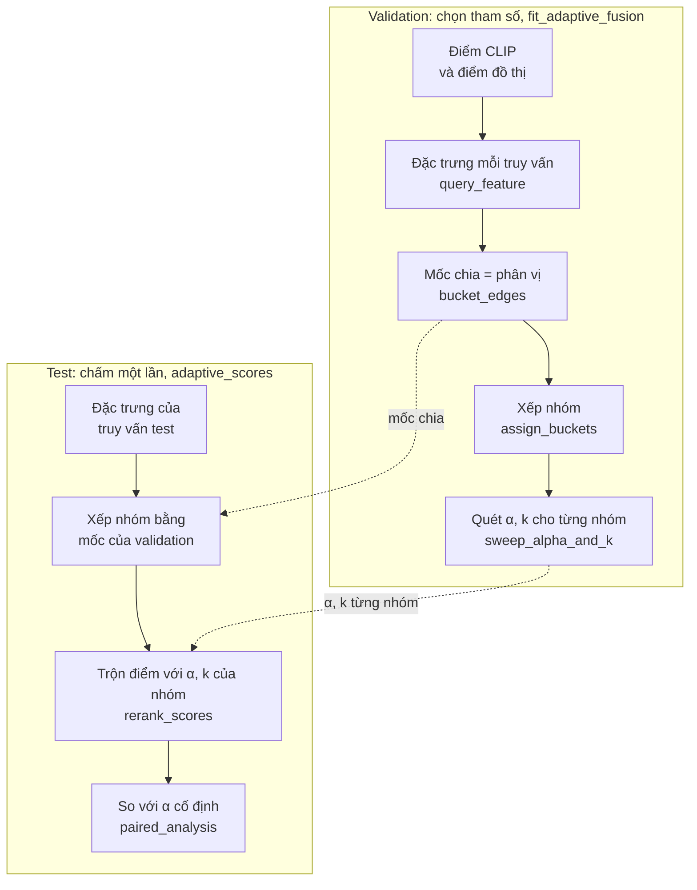

# Kết hợp điểm thích nghi theo từng truy vấn

Đề xuất cải tiến của nhóm, thuộc hướng (a) của Cấp độ 4 trong đề: *cơ chế xếp hạng lại hoặc kết hợp điểm thích nghi*.

**Trạng thái:** code và test đã xong, **chưa có kết quả**. Chạy theo mục [Cách chạy](#cách-chạy), rồi điền số vào [bảng kết quả](#bảng-kết-quả-điền-sau-khi-chạy).

**Bản dễ đọc cho người mới:** mở `docs/adaptive-fusion.html` bằng trình duyệt (không cần mạng). Trang có phần tóm tắt 2 phút, ví dụ tự kéo thử, hình minh hoạ, từ điển thuật ngữ và phần hỏi đáp.

| Thành phần | File |
|---|---|
| Thuật toán | `src/retrieval/adaptive_fusion.py` |
| Script chạy | `scripts/evaluate_adaptive_fusion.py` |
| Config | `configs/evaluation/adaptive_fusion.yaml` |
| Test | `tests/retrieval/test_adaptive_fusion.py` |

**Mục lục:** [Ý tưởng](#ý-tưởng) · [Giả thuyết](#giả-thuyết) · [Cách làm](#cách-làm) · [Ví dụ tính tay](#ví-dụ-tính-tay) · [Vì sao không rò rỉ dữ liệu test](#vì-sao-không-rò-rỉ-dữ-liệu-test) · [Đi qua code](#đi-qua-code) · [Cách chạy](#cách-chạy) · [Đọc file kết quả](#đọc-file-kết-quả) · [Bảng kết quả](#bảng-kết-quả-điền-sau-khi-chạy) · [Giới hạn và hướng mở rộng](#giới-hạn-và-hướng-mở-rộng) · [Kiến thức nền](#kiến-thức-nền)

## Ý tưởng

Hệ thống hiện dùng **một** α và một k cho mọi truy vấn:

```
điểm cuối = α · điểm CLIP + (1 − α) · điểm đồ thị        (trong k ứng viên đầu của CLIP)
```

Nhưng không phải truy vấn nào cũng cần đồ thị như nhau:

- **Khi CLIP đã chắc chắn**, tức ảnh hạng 1 bỏ xa ảnh hạng 2, điểm đồ thị dễ làm hỏng một kết quả vốn đã đúng.
- **Khi CLIP phân vân**, tức hai ảnh đầu sát điểm nhau, điểm đồ thị là thông tin bổ sung có ích nhất.

Đề xuất của nhóm là chia truy vấn thành vài nhóm theo độ tự tin của CLIP, và cho mỗi nhóm một α, k riêng.

## Giả thuyết

- **H1.** Cho mỗi nhóm truy vấn một α riêng, theo độ tự tin của CLIP, làm R@1 trên test cao hơn α cố định. Nhóm CLIP phân vân sẽ chọn α thấp hơn, tức dựa vào đồ thị nhiều hơn, so với nhóm CLIP chắc chắn.
- **Đối chứng.** Nếu chia nhóm **ngẫu nhiên** cũng tăng tương tự, thì mức tăng chỉ do có thêm tham số để khớp với validation, chứ không do độ tự tin của CLIP. Đối chứng ngẫu nhiên có cùng kích thước nhóm và cùng số tham số được chọn.

## Cách làm

1. **Đặc trưng.** Với mỗi truy vấn, tính *margin* = điểm CLIP của ảnh hạng 1 − điểm CLIP của ảnh hạng 2. Đặc trưng này không dùng nhãn, nên tính được cả lúc chạy thật.
2. **Chia nhóm trên validation.** Cắt validation thành B nhóm tại các phân vị của margin, với B ∈ {2, 3, 4}. Ví dụ B = 2 cắt tại trung vị. Mốc so sánh là α cố định, tức bộ xếp hạng chính thức; script luôn chạy mốc này.
3. **Chọn tham số cho từng nhóm.** Mỗi nhóm chọn (α, k) riêng bằng **đúng** hàm quét chính thức `sweep_alpha_and_k`: lưới α bước 0,01, lưới k {10, …, 1.500}. Luật hoà cũng giữ nguyên: R@1, rồi MRR, rồi α lớn hơn, rồi k nhỏ hơn.
4. **Chấm test.** Tính margin cho từng truy vấn test, xếp truy vấn vào nhóm theo **mốc chia của validation**, rồi dùng (α, k) của nhóm đó. Test chỉ được chấm một lần.

Ký hiệu: $s^{C}_{q,i}$ và $s^{G}_{q,i}$ là điểm CLIP và điểm đồ thị của truy vấn $q$ với ảnh $i$; $b(q)$ là nhóm của $q$; $\alpha_b$ và $k_b$ là tham số của nhóm $b$. Điểm cuối của $q$ với ảnh $i$ là

$$
s_{q,i}=\begin{cases}
\alpha_{b(q)} s^{C}_{q,i}+\bigl(1-\alpha_{b(q)}\bigr) s^{G}_{q,i} & i\in \mathrm{Top}_{k_{b(q)}}(q)\\
s^{C}_{q,i}-3 & i\notin \mathrm{Top}_{k_{b(q)}}(q)
\end{cases}
$$

với $\mathrm{Top}_{k}(q)$ là k ảnh có điểm CLIP cao nhất của $q$. Điểm cosine nằm trong [−1, 1], nên trừ 3 đẩy mọi ảnh ngoài top-k xuống sau mọi ứng viên mà vẫn giữ thứ tự CLIP giữa chúng. Đây đúng là luật của bộ xếp hạng chính thức; điểm khác duy nhất là α và k phụ thuộc vào nhóm.

**Vì sao chọn riêng từng nhóm vẫn là tối ưu chung.** Điểm cuối của một truy vấn chỉ phụ thuộc vào hàng điểm của chính nó. Gọi $n_b$ là số truy vấn validation của nhóm $b$ và $n$ là tổng số truy vấn, khi đó

$$
\mathrm{R@1}=\sum_{b}\frac{n_b}{n}\mathrm{R@1}_b ,
$$

và mỗi số hạng chỉ phụ thuộc vào $(\alpha_b, k_b)$ của nhóm đó. Tổng lớn nhất khi từng số hạng lớn nhất, nên chọn tốt nhất cho từng nhóm cũng là chọn tốt nhất cho toàn bộ. MRR cũng là trung bình theo truy vấn nên tách theo nhóm được y như vậy. Vì thế luật chọn "R@1 trước, rồi MRR" cho cùng kết quả dù áp dụng cho từng nhóm hay cho toàn bộ.

## Ví dụ tính tay

Ví dụ này chính là dữ liệu của test `test_each_bucket_gets_its_own_setting_where_one_alpha_cannot_serve_both`, nên mọi con số dưới đây đều được test kiểm lại.

Validation có 3 ảnh và 8 truy vấn thuộc hai loại, mỗi loại 4 truy vấn giống nhau:

| Loại truy vấn | Điểm CLIP (ảnh 0 · 1 · 2) | Điểm đồ thị (ảnh 0 · 1 · 2) | Ảnh đúng |
|---|---|---|---|
| CLIP phân vân | 0,30 · 0,28 · 0,00 | 0,0 · 0,1 · 0,0 | ảnh 1 |
| CLIP chắc chắn | 0,60 · 0,55 · 0,00 | 0,0 · 1,0 · 0,0 | ảnh 0 |

Ở loại thứ nhất, CLIP xếp sai (ảnh 0 trên ảnh 1) nhưng chỉ hơn 0,02, còn đồ thị nghiêng nhẹ về ảnh đúng. Ở loại thứ hai, CLIP xếp đúng, còn đồ thị nghiêng mạnh về ảnh sai. Lưới α là 0; 0,01; …; 1, lưới k là {2, 3}. k = 3 không cho kết quả tốt hơn k = 2, và khi hoà thì luật chọn k nhỏ hơn, nên mọi lựa chọn dưới đây đều có k = 2: hai ứng viên là ảnh 0 và ảnh 1, còn ảnh 2 bị trừ 3 và luôn đứng cuối.

**Bước 1: margin** (`clip_margin`).

- Phân vân: 0,30 − 0,28 = 0,02.
- Chắc chắn: 0,60 − 0,55 = 0,05.

**Bước 2: mốc chia với B = 2** (`bucket_edges`). Mốc là trung vị của 8 margin. Xếp tăng dần: 0,02 0,02 0,02 0,02 0,05 0,05 0,05 0,05. Trung vị nằm giữa giá trị thứ 4 và thứ 5: (0,02 + 0,05) / 2 = **0,035**; cách tính có ở mục [Kiến thức nền](#phân-vị-và-mốc-chia). Theo `assign_buckets`, nhóm 0 (margin ≤ 0,035) gồm 4 truy vấn phân vân, nhóm 1 gồm 4 truy vấn chắc chắn.

**Bước 3: α nào đưa ảnh đúng lên hạng 1.**

- Phân vân, cần ảnh 1 trên ảnh 0:
  - ảnh 0: 0,30α + (1 − α) · 0 = 0,30α
  - ảnh 1: 0,28α + (1 − α) · 0,1 = 0,1 + 0,18α
  - 0,1 + 0,18α > 0,30α ⇔ 0,1 > 0,12α ⇔ α < 0,1 / 0,12 = **0,833…**
- Chắc chắn, cần ảnh 0 trên ảnh 1:
  - ảnh 0: 0,60α
  - ảnh 1: 0,55α + (1 − α) · 1,0 = 1 − 0,45α
  - 0,60α > 1 − 0,45α ⇔ 1,05α > 1 ⇔ α > 1 / 1,05 = **0,952…**

Không α nào vừa nhỏ hơn 0,833 vừa lớn hơn 0,952.

**Bước 4: α cố định**, tức một α cho cả 8 truy vấn, chọn bằng hàm quét chính thức. Mỗi α chỉ đúng được nhiều nhất một loại, nên R@1 tốt nhất là 4/8 = 50%. Có hai vùng đạt 50%: α ≤ 0,83 (đúng loại phân vân) và α ≥ 0,96 (đúng loại chắc chắn). Ở cả hai vùng, loại bị sai có ảnh đúng ở hạng 2, nên MRR đều bằng (4 · 1 + 4 · 0,5) / 8 = 0,75. Hoà cả R@1 lẫn MRR, luật hoà chọn α lớn hơn: **α = 1,0, k = 2**. Nghĩa là trong ví dụ này, α cố định bỏ hẳn điểm đồ thị.

**Bước 5: hai nhóm** (`fit_adaptive_fusion`). Mỗi nhóm chạy hàm quét chính thức trên 4 truy vấn của mình:

- Nhóm 0 (phân vân): mọi α ≤ 0,83 đều đạt R@1 = 100%. Luật hoà chọn α lớn nhất: **α = 0,83, k = 2**.
- Nhóm 1 (chắc chắn): mọi α ≥ 0,96 đều đạt 100%. Luật hoà chọn **α = 1,0, k = 2**.

Điểm trộn tại các α vừa chọn:

| Truy vấn | α | Ảnh 0 | Ảnh 1 | Ảnh đúng ở hạng 1? |
|---|---|---|---|---|
| Phân vân, dùng α cố định | 1,0 | 0,300 | 0,280 | Không |
| Phân vân, dùng α của nhóm 0 | 0,83 | 0,249 | 0,2494 | Có |
| Chắc chắn, dùng α cố định hoặc α của nhóm 1 | 1,0 | 0,600 | 0,550 | Có |
| Chắc chắn, nếu dùng α của nhóm 0 | 0,83 | 0,498 | 0,6265 | Không |

Chia nhóm đạt R@1 = 100% trên 8 truy vấn, so với 50% của α cố định. Để ý α = 0,83 của nhóm 0 nằm sát ngưỡng 0,833: trong các α tốt như nhau, luật hoà luôn chọn α gần CLIP nhất.

**Bước 6: chấm test** (`adaptive_scores`). Truy vấn test dùng mốc 0,035 của validation, không tính mốc mới. Ví dụ, truy vấn test có điểm CLIP 0,30 · 0,27 · 0,00 có margin 0,03 ≤ 0,035, nên vào nhóm 0 và dùng α = 0,83, k = 2. Test `test_scoring_another_split_uses_the_validation_edges` kiểm đúng điều này: ba truy vấn có margin 0,01, 0,02 và 0,03 đều vào nhóm 0, dù trung vị của riêng ba truy vấn đó là 0,02.

## Vì sao không rò rỉ dữ liệu test

- **Mốc chia và (α, k) chỉ lấy từ validation.** Hàm `fit_adaptive_fusion` từ chối mọi tập khác validation.
- **Margin không dùng nhãn.** Nó chỉ dùng điểm CLIP của chính truy vấn, thông tin vốn có sẵn lúc chạy thật.
- **Mốc α cố định là bộ xếp hạng chính thức.** Script chọn (α, k) bằng đúng hàm quét chính thức trên toàn bộ validation, so với lựa chọn trong file benchmark của `run_benchmark` cho từng seed, và **dừng nếu khác**. Nhờ vậy mọi so sánh đều dùng đúng mốc chính thức.
- **Test chấm một lần,** sau khi đã chốt mọi thứ trên validation.

Mỗi điều trên đều có test kiểm; danh sách đầy đủ ở mục [Các test](#các-test).

## Đi qua code



### Module thuật toán

`src/retrieval/adaptive_fusion.py` chỉ gồm hàm thuần: không đọc ghi file, trừ phần đọc config. Vì vậy mọi hàm đều test được bằng dữ liệu dựng tay.

| Hàm / lớp | Làm gì |
|---|---|
| `BucketFeature` | Tên các đặc trưng chia nhóm: `clip_margin` và `random` |
| `clip_margin(clip_scores)` | Margin của mọi truy vấn: điểm CLIP cao nhất trừ điểm cao thứ hai trong hàng. Dùng `np.partition` để lấy hai giá trị lớn nhất mà không phải sắp xếp cả hàng. Báo lỗi nếu có ít hơn 2 ảnh hoặc có giá trị NaN, vô cực |
| `random_feature(query_ids, seed)` | Đặc trưng của đối chứng: mỗi truy vấn nhận một số trong [0, 1) từ một bộ sinh ngẫu nhiên riêng, khởi tạo bằng chuỗi `"<seed>:<query_id>"`. Giá trị chỉ phụ thuộc vào seed và id, không phụ thuộc thứ tự truy vấn hay tập dữ liệu, nên validation và test có cùng phân phối |
| `query_feature(feature, ...)` | Gọi đúng hàm đặc trưng theo tên; báo lỗi nếu gặp đặc trưng chưa có code |
| `bucket_edges(values, n_buckets)` | Mốc chia: các phân vị mức 1/B, …, (B − 1)/B của đặc trưng trên validation. Mốc trùng nhau được gộp, nên khi nhiều giá trị bằng nhau có thể ra ít nhóm hơn yêu cầu |
| `assign_buckets(values, edges)` | Số thứ tự nhóm của từng giá trị, đánh số từ 0. Nhóm 0 chứa giá trị nhỏ hơn hoặc bằng mốc đầu tiên; nhóm cuối chứa giá trị lớn hơn mốc cuối cùng; giá trị nằm đúng trên một mốc thuộc nhóm phía dưới mốc đó |
| `fit_adaptive_fusion(...)` | Bước chọn tham số. Kiểm tra tập đầu vào là validation và kích thước ma trận điểm khớp; tính đặc trưng, mốc chia, nhóm; rồi với mỗi nhóm gọi hàm quét chính thức `sweep_alpha_and_k` trên đúng các truy vấn của nhóm. Nhóm có ít hơn `min_bucket_queries` truy vấn bị từ chối. Trả về `AdaptiveFusion` |
| `_subset(data, rows)` | Giữ nguyên bộ ảnh, chỉ giữ các truy vấn của một nhóm, để đưa vào hàm quét |
| `AdaptiveFusion` | Kết quả đã chọn: đặc trưng, seed, mốc chia, và một `SweepPoint` (α, k, chỉ số trên validation) cho mỗi nhóm. Tự kiểm tra số setting bằng số mốc cộng 1. `to_dict()` tạo phần `fit` trong file kết quả |
| `adaptive_scores(fusion, ...)` | Bước chấm điểm. Tính đặc trưng của các truy vấn cần chấm, xếp nhóm bằng **mốc của validation**, rồi trộn điểm từng nhóm bằng `rerank_scores` với (α, k) của nhóm đó. Không chọn hay tính lại gì trên tập đang chấm |
| `AdaptiveFusionConfig` | Đọc file YAML và kiểm tra từng trường; xem [Các trường trong config](#các-trường-trong-config) |

### Code chính thức được dùng lại

Tính năng không tự viết lại luật chọn tham số, luật trộn điểm hay cách đo. Mọi phép đó đều gọi code có sẵn của dự án, nên kết quả so trực tiếp được với benchmark.

| Hàm | File | Dùng để |
|---|---|---|
| `sweep_alpha_and_k`, `SweepPoint` | `src/retrieval/rerank.py` | Quét lưới α, k trên validation và chọn theo luật hoà chính thức |
| `rerank_scores` | `src/retrieval/rerank.py` | Trộn điểm CLIP và điểm đồ thị trong top-k |
| `ranks_of_relevant`, `retrieval_metrics` | `src/evaluation/metrics.py` | Hạng của ảnh đúng; R@K, MRR |
| `build_split_data`, `clip_scores`, `graph_vector_scores`, `aggregate_runs` | `src/evaluation/benchmark.py` | Dựng dữ liệu từng tập, tính ma trận điểm, tính trung bình ± độ lệch chuẩn qua seed |
| `paired_analysis` | `src/evaluation/ablation_analysis.py` | Bootstrap ghép cặp theo cụm, giống `analyze_ablation` |
| `verify_inputs_unchanged`, `load_table`, `table_paths` | `src/embeddings/store.py` | Nạp vector và kiểm tra đầu vào chưa đổi |
| `validate_run`, `validate_artifact_inputs` | `src/models/run_validation.py` | Kiểm tra thư mục run và file benchmark |

### Script, từng bước

Hàm `run` trong `scripts/evaluate_adaptive_fusion.py` làm lần lượt:

1. **Đọc config.** `AdaptiveFusionConfig` đọc `configs/evaluation/adaptive_fusion.yaml`, rồi `RetrievalConfig` đọc config ghi ở `retrieval_config`: mô hình CLIP, tên run, 3 seed, lưới α và k.
2. **Nạp vector CLIP và dựng dữ liệu.** `verify_inputs_unchanged` báo lỗi nếu file đầu vào của vector đã thay đổi kể từ lúc tạo vector. Sau đó dựng dữ liệu validation và test (`build_split_data`) và ma trận điểm CLIP (`clip_scores`).
3. **Đọc file benchmark** `runs/benchmark/graphsage-<run>.json`. `validate_artifact_inputs` từ chối file benchmark cũ, tức file được tạo từ những đầu vào nay đã đổi.
4. **Với mỗi seed:**
   1. `validate_run` từ chối run có kiến trúc, seed, mô hình CLIP hoặc dữ liệu huấn luyện không khớp với config. Sau đó nạp `graph_vectors` và tính ma trận điểm đồ thị (`graph_vector_scores`).
   2. **Mốc α cố định.** `sweep_alpha_and_k` chọn một (α, k) trên toàn bộ validation; `_check_official` so với lựa chọn trong file benchmark và dừng nếu khác. Rồi chấm validation và test bằng `rerank_scores` với (α, k) đó.
   3. **Mỗi cách chia**, tức mỗi đặc trưng × mỗi số nhóm: `fit_adaptive_fusion` trên validation, rồi `adaptive_scores` cho validation và test. `_bucket_rows` tính cho từng nhóm số truy vấn, R@1 của cách chia và R@1 của α cố định trên cùng các truy vấn đó.
5. **Gộp qua seed.** `aggregate_runs` tính trung bình và độ lệch chuẩn; `paired_analysis` so từng cách chia với α cố định trên test.
6. **Ghi file kết quả** bằng `write_json`, gồm:
   - `results`: kết quả của α cố định và của từng cách chia;
   - `protocol`: mô tả ngắn cách làm;
   - `inputs_sha256`: mã băm SHA-256 của mọi file đầu vào (hai file config, vector CLIP, file split, file benchmark, và config cùng `graph_vectors` của từng seed). Nhờ đó, sau này vẫn kiểm được kết quả được tạo từ đúng những file nào.

### Khi nào script dừng

| Tình huống | Lỗi | Cách xử lý |
|---|---|---|
| (α, k) của mốc α cố định khác file benchmark | `DataError` | File benchmark không được tạo từ đúng vector và lưới hiện có: chạy lại `run_benchmark --method graphsage` |
| File đầu vào của vector, của run hoặc của benchmark đã thay đổi | `DataError` | Chạy lại bước tạo ra file đó |
| Một nhóm có ít hơn `min_bucket_queries` truy vấn validation | `ConfigError` | Bớt số nhóm trong `n_buckets` hoặc giảm `min_bucket_queries` |
| Config sai: đặc trưng lạ, số nhóm nhỏ hơn 2 hoặc bị trùng, trường thiếu hay sai kiểu | `ConfigError` | Sửa file YAML |

Các lỗi trên đều thuộc `AppError`: script ghi lỗi ra log, trả exit code 1 và **không ghi** file kết quả. Ngoài ra `fit_adaptive_fusion` từ chối chọn tham số trên tập khác validation (`DataError`). Script không bao giờ gọi như vậy, nhưng chặn này giữ cho ai dùng lại hàm cũng không thể vô tình chọn tham số trên test.

### Các trường trong config

| Trường | Ý nghĩa | Mặc định |
|---|---|---|
| `retrieval_config` | Config của run cần đánh giá: mô hình CLIP, tên run, các seed, lưới α và k | `configs/retrieval/ablations/full.yaml` |
| `features` | Các đặc trưng chia nhóm sẽ chạy, không trùng nhau | `[clip_margin, random]` |
| `n_buckets` | Các số nhóm sẽ thử; mỗi số ≥ 2 và không trùng. α cố định luôn được chạy nên không ghi ở đây | `[2, 3, 4]` |
| `min_bucket_queries` | Số truy vấn validation tối thiểu để một nhóm được chọn (α, k) riêng | `500` |
| `feature_seed` | Seed của đối chứng ngẫu nhiên; không ảnh hưởng `clip_margin` | `2026` |
| `bootstrap_repeats` | Số lần lấy mẫu lại trong bootstrap ghép cặp | `2000` |
| `bootstrap_seed` | Seed của bootstrap | `310` |
| `output` | File JSON kết quả | `runs/analysis/adaptive_fusion.json` |

Với 7.500 truy vấn validation và B = 4, mỗi nhóm có khoảng 1.875 truy vấn, vượt xa mức 500.

### Các test

Chạy bằng `pytest tests/retrieval/test_adaptive_fusion.py`, không cần dữ liệu thật.

| Test | Kiểm điều gì |
|---|---|
| `test_clip_margin_is_top_one_minus_top_two` | Margin là điểm cao nhất trừ điểm cao thứ hai, dù hai điểm đó nằm ở cột nào; hai điểm đầu bằng nhau thì margin bằng 0 |
| `test_clip_margin_needs_two_items` | Ít hơn 2 ảnh thì báo lỗi |
| `test_random_feature_depends_only_on_seed_and_query_id` | Mỗi truy vấn một giá trị khác nhau; không phụ thuộc thứ tự; đổi seed thì đổi giá trị; giá trị nằm trong [0, 1) |
| `test_bucket_edges_are_quantiles_and_tied_quantiles_collapse` | Mốc chia đúng là phân vị; mốc trùng được gộp; số nhóm bằng 0 bị từ chối |
| `test_a_value_on_an_edge_goes_to_the_lower_bucket` | Giá trị nằm đúng trên mốc thuộc nhóm dưới |
| `test_one_bucket_reproduces_the_official_selection_and_scores` | Một nhóm cho ra đúng lựa chọn và đúng điểm của bộ xếp hạng chính thức |
| `test_each_bucket_gets_its_own_setting_where_one_alpha_cannot_serve_both` | Ví dụ ở mục [Ví dụ tính tay](#ví-dụ-tính-tay): α cố định đạt 50%, hai nhóm đạt 100% |
| `test_fitting_refuses_any_split_but_validation` | Chọn tham số trên test bị từ chối |
| `test_buckets_too_small_to_select_on_are_refused` | Nhóm quá nhỏ, hoặc nhóm rỗng do giá trị bằng nhau, bị từ chối |
| `test_scoring_another_split_uses_the_validation_edges` | Tập được chấm dùng mốc của validation, không tự tính lại |
| `test_alpha_one_in_every_bucket_keeps_the_clip_ranking` | α = 1 ở mọi nhóm giữ nguyên thứ hạng CLIP |
| `test_a_fitted_fusion_needs_one_setting_per_bucket` | Số setting phải bằng số nhóm |
| `test_config_rejects_invalid_values` (11 trường hợp) | Config sai bị từ chối |
| `test_shipped_config_is_valid` | File config đi kèm hợp lệ |
| `test_script_compares_every_bucketing_with_the_fixed_baseline` | Chạy cả script trên dữ liệu dựng tay: có đủ các mục kết quả, và chênh lệch ghép cặp tính đúng chiều (+50 điểm %) |
| `test_script_stops_when_one_bucket_differs_from_the_benchmark` | File benchmark ghi (α, k) khác thì script trả exit 1 và không ghi file kết quả |

Bộ test cũng đã được kiểm bằng cách cố ý gài lỗi vào code, chẳng hạn bỏ bước so với benchmark, cho phép chọn tham số trên test, hay đảo chiều phép so sánh. Lần nào test cũng fail, tức các test thực sự bắt được những lỗi đó.

## Cách chạy

Điều kiện: máy phải có vector CLIP (`data/processed/vg_coco/embeddings/`), và đã chạy `train_graphsage` lẫn `run_benchmark --method graphsage` cho config ghi ở `retrieval_config`. Mặc định là `configs/retrieval/ablations/full.yaml`, tức mô hình chính.

```bash
python -m scripts.evaluate_adaptive_fusion                 # dùng configs/evaluation/adaptive_fusion.yaml
pytest tests/retrieval/test_adaptive_fusion.py             # test, không cần dữ liệu thật
```

Script không huấn luyện lại và không cần GPU. Với config mặc định, mỗi seed quét lưới α, k trên toàn bộ validation 7 lần: 1 lần cho α cố định, cộng 2 đặc trưng × 3 số nhóm. Một lần quét trên 7.500 truy vấn validation mất khoảng 25–30 giây trên CPU (đo trên Apple M3), nên cả lượt chạy 3 seed mất khoảng 10–15 phút. Kết quả được ghi ra `runs/analysis/adaptive_fusion.json`; thư mục này bị `.gitignore` bỏ qua, nên muốn commit thì dùng `git add -f`.

## Đọc file kết quả

`results` có mục `fixed` cho α cố định, và một mục cho mỗi cách chia: `clip_margin-b2`, `clip_margin-b3`, …, `random-b2`, … Mỗi mục gồm:

| Trường | Nội dung |
|---|---|
| `seeds.<seed>.fit` | Với `fixed`: α, k chọn trên toàn bộ validation. Với cách chia: mốc chia (`edges`) và α, k của từng nhóm (`buckets`) |
| `seeds.<seed>.val` và `.test` | `metrics`: R@1/5/10, MRR. Với cách chia, thêm `buckets`, theo đúng thứ tự trong `fit.buckets`: số truy vấn, R@1 của cách chia này và của α cố định trên **cùng** các truy vấn đó |
| `summary` | Trung bình ± độ lệch chuẩn qua 3 seed |
| `paired_vs_fixed_test` | Chỉ có ở các cách chia. Chênh lệch R@1 so với α cố định trên test (`delta_r1_pp`, đơn vị điểm phần trăm) và khoảng 95% của bootstrap ghép cặp, gom theo ảnh đúng; xem [Kiến thức nền](#bootstrap-ghép-cặp-theo-cụm). Đây là cùng thủ tục mà `analyze_ablation` dùng. Trong `per_seed`, "full" là cách chia và "variant" là α cố định |

## Bảng kết quả (điền sau khi chạy)

| Cách chia | Số nhóm | R@1 test (± độ lệch chuẩn) | Chênh lệch với α cố định | Khoảng 95% |
|---|---|---|---|---|
| α cố định | 1 | | — | — |
| Theo margin của CLIP | 2 | | | |
| Theo margin của CLIP | 3 | | | |
| Theo margin của CLIP | 4 | | | |
| Ngẫu nhiên (đối chứng) | 2 | | | |
| Ngẫu nhiên (đối chứng) | 3 | | | |
| Ngẫu nhiên (đối chứng) | 4 | | | |

Kết quả **ủng hộ H1** khi cả ba điều sau cùng đúng:

1. Chia theo margin cho chênh lệch dương, với khoảng 95% không chứa 0.
2. Chia ngẫu nhiên không cho mức tăng tương tự.
3. Nhóm margin nhỏ chọn α thấp hơn nhóm margin lớn. Xem trong `fit.buckets`.

Nếu chỉ validation tăng còn test không tăng, cách chia đang khớp quá mức với validation. Nên báo cáo thẳng điều đó, kèm số nhóm mà hiện tượng bắt đầu xảy ra.

## Giới hạn và hướng mở rộng

- **Nhiều nhóm hơn thì nhiều tham số hơn**, nên dễ khớp quá mức với validation. Đối chứng ngẫu nhiên và kết quả trên test là hai cách kiểm điều này. Tham số `min_bucket_queries` (mặc định 500) chặn các nhóm quá nhỏ.
- **Margin chỉ là một đặc trưng.** Có thể thêm: độ lệch giữa thứ hạng CLIP và thứ hạng đồ thị; số từ chỉ quan hệ trong câu; hoặc học α(q) bằng một hàm logistic trên validation.
- **Cấp độ 4 hướng (a) yêu cầu thực nghiệm trên ít nhất 2 tập công khai.** Code không phụ thuộc tập dữ liệu, chỉ cần config retrieval của tập kia, nên chạy lại được ngay khi có tập thứ hai.
- **Hiện script chỉ đọc run GraphSAGE** ghi trong `retrieval_config`. Muốn áp dụng cho mô hình khác, ví dụ AdaMF-MAT, cần thêm phần đọc vector của mô hình đó; hàm `fit_adaptive_fusion` và `adaptive_scores` thì dùng lại được nguyên vẹn.

## Kiến thức nền

### Phân vị và mốc chia

Phân vị mức p của một tập giá trị là giá trị mà khoảng p · 100% số giá trị nhỏ hơn hoặc bằng nó; trung vị là phân vị mức 0,5. Code dùng cách tính mặc định của `np.quantile`, tức nội suy tuyến tính. Xếp n giá trị tăng dần $x_{(0)}\le x_{(1)}\le\dots\le x_{(n-1)}$ và đặt $h=p(n-1)$, khi đó

$$
Q(p)=x_{(\lfloor h\rfloor)}+\bigl(h-\lfloor h\rfloor\bigr)\bigl(x_{(\lfloor h\rfloor+1)}-x_{(\lfloor h\rfloor)}\bigr).
$$

Muốn B nhóm có số truy vấn gần bằng nhau, lấy B − 1 mốc $e_j=Q(j/B)$ với $j=1,\dots,B-1$. Với $m(q)$ là margin của truy vấn $q$, nhóm của nó là

$$
b(q)=\begin{cases}
0 & m(q)\le e_1\\
j & e_j< m(q)\le e_{j+1}\\
B-1 & m(q)> e_{B-1}
\end{cases}
$$

Ví dụ với 4 giá trị 1, 2, 3, 4 và B = 4 (n − 1 = 3):

| p | h = 3p | Q(p) |
|---|---|---|
| 0,25 | 0,75 | 1 + 0,75 · (2 − 1) = 1,75 |
| 0,50 | 1,50 | 2 + 0,50 · (3 − 2) = 2,5 |
| 0,75 | 2,25 | 3 + 0,25 · (4 − 3) = 3,25 |

Ở [Ví dụ tính tay](#ví-dụ-tính-tay), n = 8 và p = 0,5 nên h = 3,5. Giá trị thứ 3 và thứ 4 (đếm từ 0) là 0,02 và 0,05, nên Q(0,5) = 0,02 + 0,5 · 0,03 = 0,035.

Hai trường hợp đặc biệt, đều có test:

- **Giá trị nằm đúng trên mốc thuộc nhóm dưới.** Với mốc 2,5, các giá trị 1,0; 2,5; 2,6; 9,0 lần lượt vào nhóm 0, 0, 1, 1.
- **Nhiều giá trị bằng nhau làm các mốc trùng nhau, và mốc trùng được gộp lại.** Sáu giá trị đều bằng 5,0 với B = 3 cho hai mốc cùng bằng 5,0, gộp thành một mốc. Khi đó nhóm trên rỗng, nên `fit_adaptive_fusion` từ chối. Margin của CLIP là số thực liên tục, nên trường hợp này gần như không xảy ra với dữ liệu thật.

### Bootstrap ghép cặp theo cụm

Đây là cách tính chênh lệch và khoảng 95% trong `paired_vs_fixed_test`, cùng thủ tục với `analyze_ablation`. Ký hiệu $[P]$ bằng 1 nếu mệnh đề $P$ đúng và bằng 0 nếu sai.

**Bước 1: hiệu theo từng truy vấn.** Với truy vấn test $q$ và $S = 3$ seed, gọi $r^{A}_{s,q}$ và $r^{F}_{s,q}$ là hạng của ảnh đúng theo cách chia và theo α cố định. Khi đó

$$
d_q=\frac{1}{S}\sum_{s=1}^{S}\Bigl(\bigl[r^{A}_{s,q}=1\bigr]-\bigl[r^{F}_{s,q}=1\bigr]\Bigr),
\qquad
\Delta=100\cdot\frac{1}{n}\sum_{q} d_q .
$$

$\Delta$ chính là `delta_r1_pp`, đơn vị điểm phần trăm.

**Bước 2: gom theo ảnh.** Năm caption của cùng một ảnh không độc lập với nhau: chúng tả cùng một ảnh nên thường cùng dễ hoặc cùng khó. Vì vậy đơn vị lấy mẫu lại là **ảnh đúng**, không phải caption. Với mỗi ảnh $c$, đặt $D_c=\sum_{q\in c} d_q$, và gọi $n_c$ là số caption của ảnh đó.

**Bước 3: lấy mẫu lại.** Mỗi lần, rút có hoàn lại $C$ ảnh $c_1,\dots,c_C$, với $C$ là số ảnh test, rồi tính

$$
\Delta^{*}=100\cdot\frac{\sum_{t=1}^{C} D_{c_t}}{\sum_{t=1}^{C} n_{c_t}} .
$$

**Bước 4: khoảng 95%.** Lặp lại `bootstrap_repeats` = 2.000 lần. Phân vị 2,5% và 97,5% của các $\Delta^{*}$ là khoảng 95%.

Ví dụ nhỏ với 3 ảnh, mỗi ảnh 2 caption, 1 seed:

| Ảnh | d của 2 caption | $D_c$ | $n_c$ |
|---|---|---|---|
| A | 1 và 0 | 1 | 2 |
| B | 0 và 0 | 0 | 2 |
| C | 1 và 1 | 2 | 2 |

- Δ = 100 · (1 + 0 + 2) / 6 = 50 điểm %.
- Một lần rút được (A, C, C): Δ* = 100 · (1 + 2 + 2) / 6 ≈ 83,3.
- Một lần rút được (B, B, A): Δ* = 100 · (0 + 0 + 1) / 6 ≈ 16,7.

**Ghép cặp** nghĩa là hai cách được so trên cùng truy vấn và cùng seed, nên độ khó riêng của từng truy vấn triệt tiêu trong hiệu $d_q$. Khoảng 95% chỉ phản ánh độ bất định do chọn mẫu truy vấn và ảnh, với 3 checkpoint đã huấn luyện cố định. Nó không nói gì về việc huấn luyện lại với seed mới.

### R@1, MRR và luật trộn điểm

- **R@1** là tỉ lệ truy vấn có ảnh đúng ở hạng 1. **MRR** là trung bình của 1 / hạng của ảnh đúng. Ví dụ hai truy vấn có ảnh đúng ở hạng 1 và hạng 2 thì R@1 = 50% và MRR = (1 + 0,5) / 2 = 0,75.
- Luật trộn điểm và lưới α, k là của bộ xếp hạng chính thức; tính năng này chỉ cho mỗi nhóm một (α, k) riêng.

Giải thích chi tiết và ví dụ tính tay của các phần này nằm trong bộ docs chung, trên branch `dacphu/docs/project-guide`: Phụ lục A, mục A3 (hạng, R@K, MRR) và mục A19 (bootstrap theo cụm); Phụ lục B, mục B7 (trộn điểm và xếp hạng lại).
